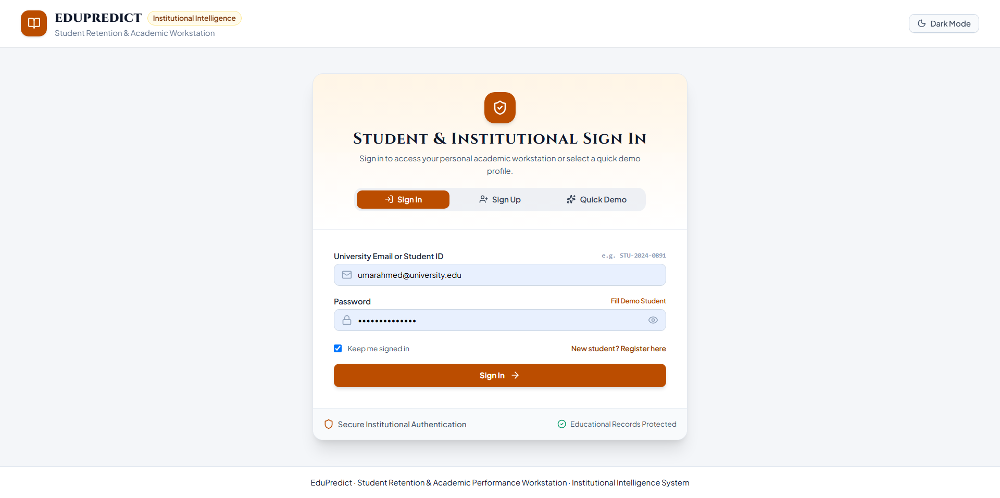
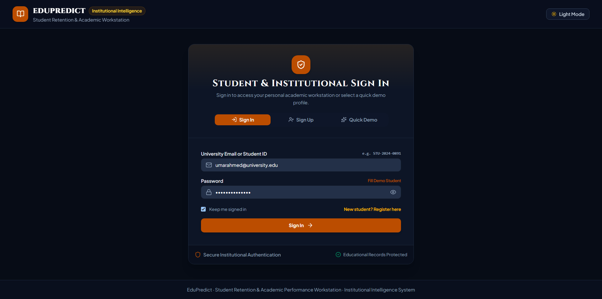
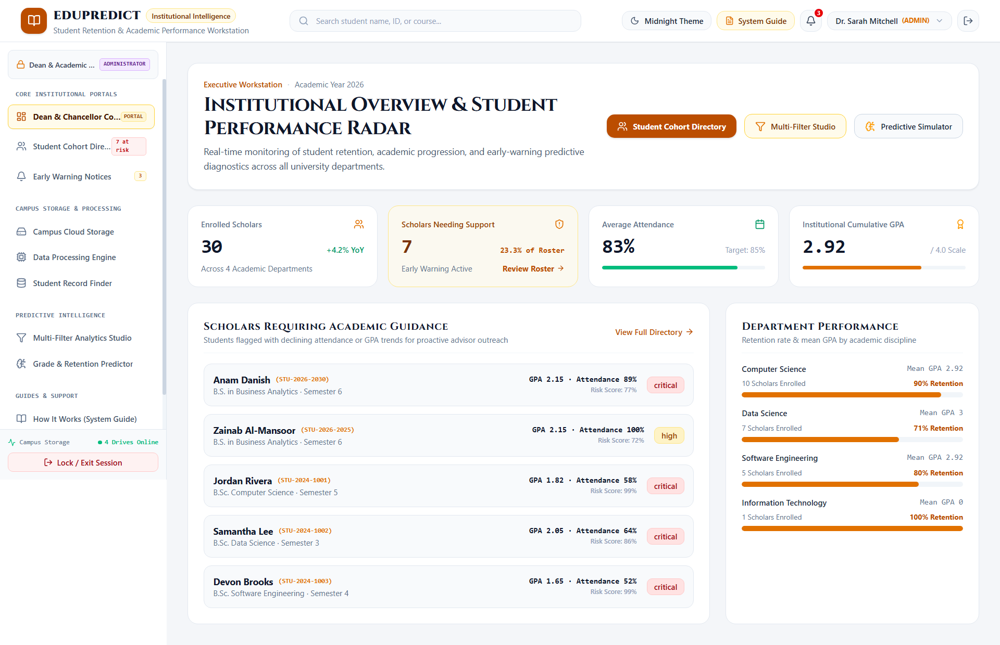
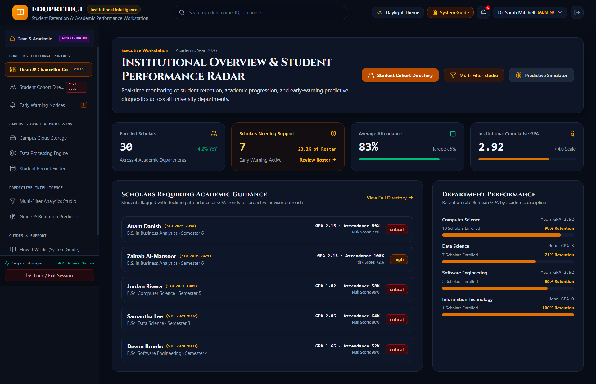

# EduPredict

### Big Data and Predictive Analytics Platform for Education

EduPredict is an academic prototype for exploring how educational data can help institutions identify students who may benefit from earlier support. It brings student, attendance, course, and learning-engagement indicators into role-based dashboards, with risk estimates, alerts, cohort analytics, and intervention tracking.

The project includes a React and TypeScript web application, a Python Flask API, optional MongoDB-backed operation, machine-learning examples, and scripts that demonstrate big-data processing workflows. The web app also includes interactive views for Hadoop, HDFS, MapReduce, and Impala concepts. Running these data services requires installing and configuring them separately; the included screens and scripts do not create a production Hadoop cluster automatically.

> **Project status:** This is an academic demonstration and development project. It is not a validated clinical, financial, or institutional decision system. Predictive indicators are intended for exploration and should not be used as the sole basis for decisions about students.

## Contents

- [Project goals](#project-goals)
- [Features](#features)
- [Screenshots](#screenshots)
- [How the workflow fits together](#how-the-workflow-fits-together)
- [Technology](#technology)
- [Repository structure](#repository-structure)
- [Requirements](#requirements)
- [Getting started](#getting-started)
- [Configuration](#configuration)
- [API overview](#api-overview)
- [Data and privacy](#data-and-privacy)
- [Known limitations](#known-limitations)
- [License](#license)

## Project goals

Institutions often review student outcomes after grades fall or attendance declines. EduPredict demonstrates a workflow for combining academic results, attendance, and learning-platform engagement into a clearer view of student progress. The intent is to help staff explore patterns, prioritize follow-up, and record support actions earlier.

The prototype focuses on:

- Bringing sample student metrics into a shared application.
- Summarizing performance and engagement through dashboards.
- Surfacing risk estimates, trends, and anomaly indicators for review.
- Supporting cohort filtering, CSV import, alerts, and advising workflows.
- Demonstrating how batch analytics and machine-learning components could fit into a broader educational data platform.

## Features

### Role-based application views

- **Administrators:** Review campus and department summaries, student cohorts, alerts, and analytics.
- **Faculty:** Review student performance and attendance, filter rosters, and record advising interventions.
- **Students:** Review personal academic and attendance information, course progress, and support-request options.
- **Analysts:** Explore predictive analytics and the big-data demonstration tools.

Access to dashboard areas is organized by role. The repository includes demo accounts for local exploration; see [SETUP_GUIDE.md](SETUP_GUIDE.md). These accounts and credentials are for demonstration only.

### Student analytics and support workflows

- Student roster search, filtering, detail views, and CSV import/export workflows.
- Academic metrics such as GPA, assessment results, and course progress.
- Attendance metrics, absence trends, and an attendance-policy calculator.
- Learning-engagement indicators such as weekly activity and assignment timeliness.
- Risk scores, risk factors, predicted GPA, behavioral group labels, and anomaly indicators.
- Alerts and support-intervention tracking.
- A multi-filter analytics dashboard for exploring student cohorts.

### Data engineering and analysis examples

The repository also contains standalone examples for PySpark ETL, HDFS ingestion, Impala SQL, MongoDB seed data, Python machine-learning workflows, and R analysis. These components are intended for learning and demonstration. External systems such as Hadoop, Spark, and Impala must be installed and configured separately if you want to run the corresponding workflows.

## Screenshots

### Login

| Light theme | Dark theme |
| --- | --- |
|  |  |

### Administrator dashboard

| Light theme | Dark theme |
| --- | --- |
|  |  |

### Other application views


## How the workflow fits together

1. **Load or review records.** The app provides sample data and a CSV import workflow for student cohort records.
2. **Calculate or display indicators.** Application services and Python analytics components use academic, attendance, and engagement fields to produce summaries and predictive indicators.
3. **Explore results by role.** Dashboards present the relevant cohort, student, alert, and analytics views to each user role.
4. **Follow up.** Faculty and administrators can review alerts and record intervention activity in the application workflow.
5. **Explore batch processing.** Separate scripts show example data ingestion, ETL, and SQL analysis patterns for big-data tooling.

## Technology

| Area | Technologies and components |
| --- | --- |
| Frontend | React 19, TypeScript, Vite, Tailwind CSS, Lucide icons |
| Backend API | Python, Flask, Flask-CORS |
| Database | MongoDB with PyMongo and MongoEngine; mock/fallback mode is also included |
| Authentication support | bcrypt password hashing and JWT support in the Flask backend |
| Machine learning | Python, scikit-learn, NumPy, pandas, Jupyter notebook, and R scripts |
| Big-data examples | HDFS, PySpark, MapReduce, and Impala SQL scripts |

See `package.json` and `backend/requirements.txt` for dependency details.

## Repository structure

```text
backend/             Flask API, MongoDB models, seed scripts, and Python requirements
big_data_pipeline/   HDFS ingestion, PySpark ETL, and Impala SQL examples
database/            MongoDB seed script and sample CSV datasets
docs/screenshots/    Login, admin, student, and analyst screenshots
machine_learning/    Dropout-risk, anomaly-detection, notebook, and R analysis files
src/                 React and TypeScript application
README.md            Project overview and local quick start
SETUP_GUIDE.md       Detailed installation, database, and demo-account guide
PROJECT_REPORT.md    Project report
```

## Requirements

For the web application and Flask backend:

- Node.js with npm.
- Python 3.10 or newer; see `SETUP_GUIDE.md` for the project guide's supported versions.
- MongoDB Community Server for database-backed local operation. The app also includes a fallback mode for demonstration when MongoDB is unavailable.

For the optional data-engineering examples, you may also need the matching external tools, such as Hadoop/HDFS, Apache Spark with PySpark, and Apache Impala. Jupyter, R, RStudio, or Tableau are only needed for their related analysis artifacts.

## Getting started

For complete prerequisites, MongoDB setup, startup behavior, manual steps, and demo-account information, read [SETUP_GUIDE.md](SETUP_GUIDE.md).

### Windows quick start

From the project root, run:

```bat
run_local.bat
```

The script prepares the local backend environment and starts the API and frontend. Check the setup guide for the exact prerequisites and behavior.

### macOS or Linux quick start

From the project root, run:

```bash
chmod +x run_local.sh
./run_local.sh
```

### Manual start

Install and start the backend in one terminal:

```bash
cd backend
python -m venv venv
```

Activate the environment, then install requirements and start the API:

```bash
# Windows PowerShell
.\venv\Scripts\Activate.ps1

# macOS or Linux
source venv/bin/activate

pip install -r requirements.txt
python app.py
```

In a second terminal, from the project root, install frontend dependencies once after cloning, then start the frontend:

```bash
npm install
npm run dev
```

The one-click startup scripts already run `npm install`, so you do not need to install frontend dependencies separately when using them. If you prefer a clean install that follows `package-lock.json`, you can use `npm ci` instead of `npm install` for the manual setup.

By default, the frontend is available at `http://localhost:3000` and the Flask API at `http://127.0.0.1:5000`. The health endpoint is `http://127.0.0.1:5000/api/v1/health`.

## Configuration

Example environment templates are provided at the project root and in `backend/`:

- Copy `.env.example` to `.env` if your local setup needs those frontend environment values.
- Copy `backend/.env.example` to `backend/.env` and set values appropriate for your local MongoDB and Flask configuration.
- Use a unique random `FLASK_SECRET_KEY` for any deployment beyond local demonstration.
- Never commit real API keys, passwords, database credentials, or `.env` files.

The application can use mock/fallback behavior if MongoDB is not running. Database persistence, authentication, and seeded account behavior depend on how the backend is configured and started.

## API overview

The Flask service exposes versioned endpoints under `/api/v1`. The implemented routes include:

| Method | Endpoint | Purpose |
| --- | --- | --- |
| `GET` | `/api/v1/health` | Backend and database health information |
| `POST` | `/api/v1/auth/register` | Register a student account |
| `POST` | `/api/v1/auth/login` | Authenticate with email or student ID |
| `GET` | `/api/v1/auth/me` | Retrieve the authenticated user's profile |
| `GET`, `POST` | `/api/v1/alerts` | Retrieve and create alerts |
| `GET`, `POST` | `/api/v1/feedback` | Retrieve and submit feedback tickets |
| `POST` | `/api/v1/predict` | Request a student risk prediction |
| `POST` | `/api/v1/interventions` | Record an intervention |
| `POST` | `/api/upload/csv` | Submit a CSV upload |

The backend source in `backend/app.py` is the authoritative reference for request fields, authentication requirements, and response formats.

## Data and privacy

The repository contains sample and demo cohort records and demo login credentials documented in `SETUP_GUIDE.md`. Do not treat these as real institutional accounts. Before publishing screenshots or test data, review them for student-identifying or otherwise private information. Do not upload real student records or secrets to a public repository.

## Known limitations

- EduPredict is a prototype; predictive outputs have not been independently validated for institutional decisions.
- Big-data screens and scripts demonstrate workflows, but a production Hadoop/Spark/Impala deployment requires separately configured infrastructure.
- The local mock mode and browser-based demo flows are intended for development and demonstration, not as production security controls.
- No automated test suite is documented in this repository; review and validate the environment-specific workflows before relying on them.

## License

No license is currently included. Without a license, reuse and redistribution are not explicitly granted. Add a license file if you want to specify permissions for others.

## Academic project

EduPredict was developed as part of the PMTZ-202310F academic project cohort. The complete project report is available in `PROJECT_REPORT.md`.
